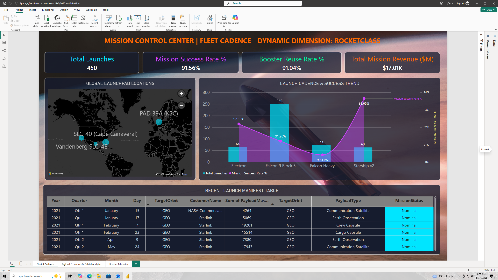

# 🚀 Aerospace Telemetry & Business Intelligence Command Center

An end-to-end **Mission Operations & Business Intelligence Analytics Suite** built in **Microsoft Power BI**. Modeled on a normalized Star Schema architecture, this 3-page interactive dashboard evaluates global launch cadence, unit payload economics, and booster hardware fatigue across 450+ orbital missions.

---

## 🖥️ Dashboard Architecture & Visual Tour

### 1. Fleet & Launch Cadence (Sheet 1)
Analyzes global launchpad distribution via interactive geospatial mapping, flight frequency trends, and mission success rates. Powered by a **Dynamic Dimension Parameter** allowing users to slice metrics dynamically by rocket class, target orbit, or customer profile.

### 2. Payload Economics & Orbital Analytics (Sheet 2)
Connects orbital physics with commercial profitability—tracking **Average Cost per KG ($2.45K)**, fairing reusability efficiency (78.67%), annual revenue trajectories, and payload mass distribution across low-Earth, geostationary, and interplanetary orbits.

### 3. Booster Telemetry & Hardware Risk (Sheet 3)
Monitors asset lifecycle and wear-and-tear by tracking refurbishment cost escalation, reflight turnaround cadence, and conditional hardware risk matrices flagging boosters approaching end-of-life flight limits.

---

## 🛠️ Technical Stack & Data Modeling

* **Data Modeling:** Star Schema (`Fact_Launches` connected to `Dim_PayloadDetails` and `Dim_BoosterTelemetry`).
* **Analytics & Calculations:** Custom DAX measures (`DIVIDE`, `CALCULATE`, time-intelligence trends, and dynamic field parameters).
* **UI/UX Design:** Custom Dark Obsidian (`#0B0E17`) and Neon-Glassmorphic card styling (`#161C2E`) engineered for high-density operational monitoring.

---

## 📂 How to Explore This Project

1. Download the `.pbix` file from this repository.
2. Open the file using **Microsoft Power BI Desktop**.
3. Navigate across the 3 operational sheets to review Fleet Cadence, Payload Economics, and Booster Telemetry.
