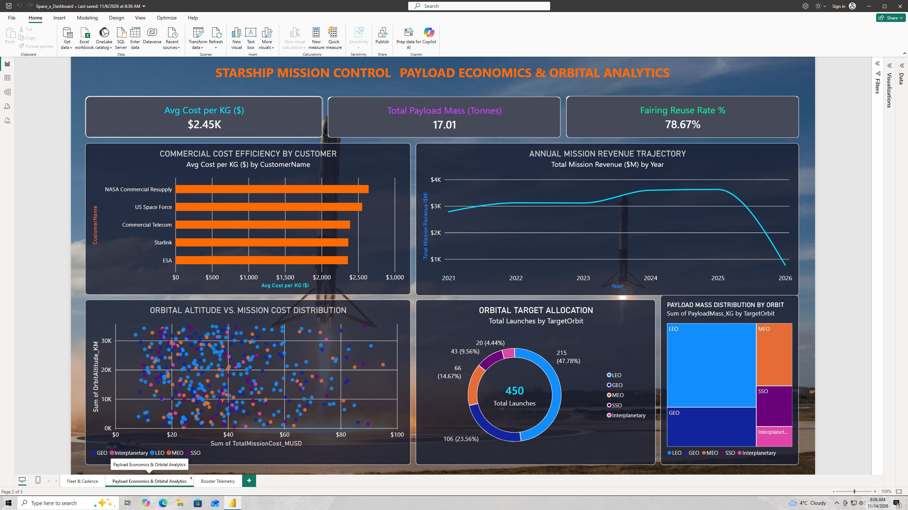

# 🚀 Aerospace Telemetry & Business Intelligence Command Center

An end-to-end **Mission Operations & Business Intelligence Analytics Suite** built in **Microsoft Power BI**. Modeled on a normalized Star Schema architecture, this 3-page interactive dashboard evaluates global launch cadence, unit payload economics, and booster hardware fatigue across 450+ orbital missions.

---

## 📊 Key Executive Metrics

* **Total Orbital Missions:** 450 Launches
* **Global Mission Success Rate:** 91.56%
* **Booster Reuse Rate:** 91.04%
* **Average Payload Cost Efficiency:** $2.45K per KG
* **Average Reflight Turnaround:** 71.39 Days

---

## 🖥️ Dashboard Architecture & Visual Tour

### 1. Fleet & Launch Cadence (Sheet 1)
Analyzes global launchpad load via interactive geospatial mapping (`SLC-40`, `PAD 39A`, `Vandenberg SLC-4E`), flight frequency combo charts, and mission status manifests. Powered by a **Dynamic Dimension Parameter** allowing users to slice metrics dynamically by rocket class, target orbit, or customer profile.


### 2. Payload Economics & Orbital Analytics (Sheet 2)
Connects orbital physics with unit commercial profitability—tracking **Average Cost per KG ($2.45K)**, fairing reusability efficiency (78.67%), annual revenue trajectories, and payload mass distribution across `LEO`, `GEO`, `MEO`, `SSO`, and `Interplanetary` orbits.



### 3. Booster Telemetry & Hardware Risk (Sheet 3)
Monitors fleet wear-and-tear by tracking refurbishment cost escalation ($104.06M total), reflight turnaround velocity, and conditional hardware risk matrices flagging boosters approaching end-of-life flight limits (`MaxFlightsAchieved` up to 21 flights).


---

## 🛠️ Technical Stack & Data Modeling

* **Data Modeling:** Star Schema (`Fact_Launches` connected via one-to-many relationships to `Dim_PayloadDetails` and `Dim_BoosterTelemetry`).
* **Analytics & DAX:** Custom DAX measures (`DIVIDE`, `CALCULATE`, time-intelligence trends, conditional risk rules, and dynamic field parameters).
* **UI/UX Design:** Custom Dark Obsidian (`#0B0E17`) and Neon-Glassmorphic card styling (`#161C2E`) engineered for high-density operational monitoring.

---

## 📂 Repository Structure

```text
Aerospace-Telemetry-PowerBI-Dashboard/
│
├── images/
│   ├── 01_Fleet_And_Cadence.png
│   ├── 02_Payload_Economics.png
│   └── 03_Booster_Telemetry.png
│
├── SpaceX_Executive_Command_Center.pbix
└── README.md
```

---

## 🚀 How to Explore This Project

1. Clone or download this repository to your local machine.
2. Open `SpaceX_Executive_Command_Center.pbix` using **Microsoft Power BI Desktop**.
3. Use the dynamic parameter slicers and interactive visuals across all 3 sheets to explore operational cadence, payload economics, and booster risk.
